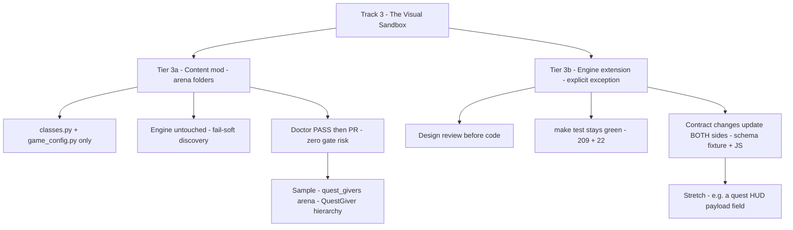
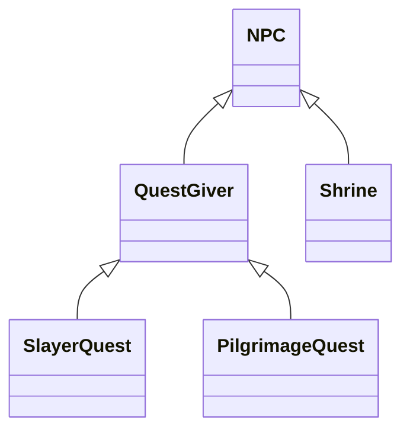

# Track 3 — RogueEdu Extension & Game Arenas (The Visual Track)

*The official visual sandbox: mod an engine that already renders, ticks, and deploys — instead of building one.*

Track 3 exists for the student who wants **visual feedback first**: a thing they can see,
play, and share within one edit→check→play loop. The pitch is not "build a game engine" —
it is **"mod an engine that already works."** Every merged arena becomes a real card on the
class arcade at `/games`, playable by anyone, at a real URL.

This document is the **rules of the track**: what you may touch, what you may not, what the
engine already gives you for free, and where the honest limits are. The sample project that
demonstrates every rule here is [`rogue_edu/arenas/quest_givers/`](rogue_edu/arenas/quest_givers/classes.py).

---

## 1. Two tiers — content mod vs. engine extension

| | **Tier 3a — Content mod** | **Tier 3b — Engine extension** |
| --- | --- | --- |
| What you edit | Your arena folder: `classes.py` + `game_config.py` | Engine, renderer, or payload contract files |
| Who it affects | Only your arena (fail-soft discovery isolates it) | Every game on the site |
| Entry gate | Doctor PASS → pull request | Design review **before** code |
| Risk | Zero — the menu cannot break | Real — guarded by the three rules below |
| Status | **Live today** | Described here; opt-in, reviewed, rare |

**Start in 3a.** Almost every creative idea — hierarchies, quests, phases, squads, puzzles —
fits Tier 3a. Reach for 3b only when the idea is *structurally* impossible in content, and
never before the design review.

## 2. The black-box amendment (surgical — nothing else moves)

The standing rule for the core curriculum tracks is unchanged:

> [`rogue_edu/engine/`](rogue_edu/engine/core.py:1) is the black box students never edit —
> the test gate guards it. ([`TEACHER_GUIDE.md`](TEACHER_GUIDE.md:199),
> [`curriculum-map.md`](curriculum/pilot_v0_1/curriculum-map.md:57))

**Track 3 amends this in exactly two places, and nowhere else:**

1. **Tier 3a never touches the engine by construction** — students edit only their own
   arena folder. The rule is not relaxed; it is simply never in the way.
2. **Tier 3b is an explicit, opt-in exception** for engine work, guarded by three rules:
   - **Design review first** — a one-paragraph proposal (what, why, which binding decision
     it touches) approved before any code.
   - **`make test` stays green** — the full gate (currently **209 pytest + 2 skipped +
     22 node**) must pass after the change. The gate is the safety net, not an obstacle.
   - **Contract changes move both sides together** — the frozen payload contract
     ([`tests/fixtures/turn_payload_schema.json`](tests/fixtures/turn_payload_schema.json:1))
     is validated by pytest **and** the jsdom tests; any payload field change updates the
     fixture, the Python emitter, and the JS renderer **in the same change**.

Tracks 1–2 (the core curriculum) are untouched by this amendment. The engine remains a
black box for them, for the exams, and for the starter files.

## 3. What the engine already gives you (Tier 3a capability matrix)

Verified against the current engine — this is the honest menu:

| You want | Tier 3a today | Needs Tier 3b |
| --- | :---: | :---: |
| New Hero / Villain / NPC classes, multi-level hierarchies | ✅ | |
| Internal state on `self` — phases, counters, quest state machines | ✅ | |
| Kill-quests and visit-quests via **wired object references** | ✅ | |
| Quest status visible to the player: symbol, name, dialogue | ✅ | |
| Map design: walls, emoji art direction, placement, registration order | ✅ | |
| Win modes: `defeat_all` / `reach_goal` / `clear_and_reach_goal` | ✅ | |
| Composition: bosses commanding squads, cross-object collaboration | ✅ | |
| A quest **HUD panel** (dedicated UI field) | | payload field + JS + schema, both sides |
| Mechanical **rewards** (heal / buff the hero) | | a new action or event channel |
| True **mid-game spawning** (new entity joins the running game) | | `SummonAction` — the engine is the sole mutator ([`necromancer_squad`](rogue_edu/arenas/necromancer_squad/classes.py:1) documents this fence) |
| Custom win conditions | | the loud `ValueError` guard must be extended |
| Animation, terrain tiles, portraits | | renderer changes in `game.js` |

**The three honest limits of Tier 3a** (publish them; let students discover them as design
constraints, not bugs):

1. **No mechanical rewards.** An NPC's only output is a `SpeakAction` — a message. Hero hp
   and attack are engine-owned. Rewards are narrative, or shaped through the win condition
   (`clear_and_reach_goal` = "clear the dungeon, then report to the goal").
2. **No quest HUD.** Quest status rides the three channels that already render: the tile
   **symbol**, the entity **name** (names flow into every log line and the board payload),
   and the **dialogue box**.
3. **`SafeGameView` answers exactly four questions** — `get_hero_position`,
   `distance_to_hero`, `get_direction_toward_hero`, `is_tile_passable`
   ([`view.py`](rogue_edu/engine/view.py:32)). It carries no villain roster, so counted
   quests work only for targets **wired by reference** in `create_game()` — which is the
   composition lesson anyway.

## 4. The sample project: specialized NPC questgiver hierarchies

The flagship Tier 3a sample — [`rogue_edu/arenas/quest_givers/`](rogue_edu/arenas/quest_givers/classes.py):

- **`QuestGiver(NPC)`** — the student-authored base class. It implements `interact()` once,
  as a **template method**: a quest state machine (`offered → accepted → done`) that calls
  one hook, `self.progress()`, which subclasses override. Subclasses inherit `interact()`
  (the doctor accepts inherited methods — it checks with `getattr`).
- **`SlayerQuest`** — `progress()` counts dead **wired villain references**.
- **`PilgrimageQuest`** — `progress()` counts **visited wired sibling NPCs**.
- **`Shrine`** — a plain NPC that records `self.visited = True` when talked to.
- **Wiring** — `create_game()` builds everyone first, then hands references over through a
  `recruit()`-style method. Constructors stay `(x, y)`-shaped because the doctor constructs
  every class as `cls(3, 3)`.
- **Visual narration** — symbol 📜 (offered) → ⚔️ (accepted) → ✅ (done), and on completion
  the giver renames itself (e.g. `Sage Elowen (quest complete!)`) so every subsequent log
  line and payload entry says the quest is done. No engine change; names already render.

What it teaches, per line: inheritance and polymorphism (a hierarchy students design),
abstraction (the template-method hook), encapsulation (state on `self`), composition
(wired references), and the fence (reading another object's state is collaboration;
mutating the world is the engine's job).

## 5. Student guide (Tier 3a)

1. Read the recipe: [`rogue_edu/arenas/README.md`](rogue_edu/arenas/README.md:1) — copy
   `_template/`, rename the folder (lowercase/underscores — it becomes your URL), set
   `TITLE`, compose the game.
2. Keep [`STUDENT_TRIAGE_CARD.md`](STUDENT_TRIAGE_CARD.md:1) open — the 4 traps, 90-second
   rule.
3. Read the worked examples in order: `sample_pair` → `inferno_drake` → `necromancer_squad`
   → `quest_givers`.
4. Check yourself: `cd rogue_edu && python check_my_class.py arenas/<your_folder>/game_config`
   — must PASS before a PR.
5. Play it: `python app.py` → `/games` → your card. Ship it: branch → PR → CI green →
   teacher merges → your card appears for everyone.

**Two files are yours:** `classes.py` and `game_config.py`. Everything else — engine,
renderer, other teams' folders — is off-limits in Tier 3a.

## 6. Teacher governance

- **What "done" looks like:** doctor PASS · `make test` green · the card plays on `/games`
  · the student can *explain* their hierarchy (the explaining-is-the-review habit).
- **Review checklist for a 3a PR:** only the pair's folder changed · `TITLE` set · doctor
  PASS · no engine imports beyond `engine.actions` / `engine.base_classes` / `engine.core`.
- **Review checklist for a 3b proposal:** names the binding decision it touches · states
  both-sides contract impact · gate stays green · teacher merges, never the student.
- **Assessment fit:** the sample maps directly onto the inheritance, method-overriding,
  polymorphism, and abstraction decks in [`slides/`](slides/index.html:1) — a student
  explaining their `QuestGiver` hierarchy is the oral-defense habit in project clothing.