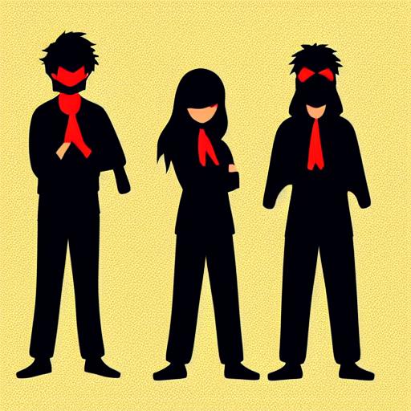
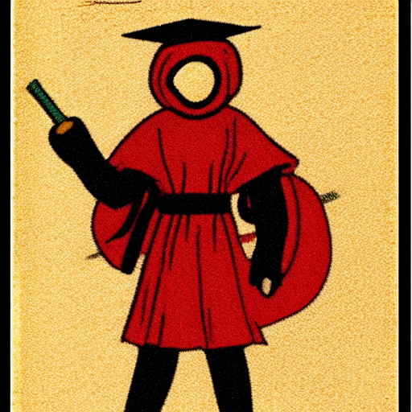
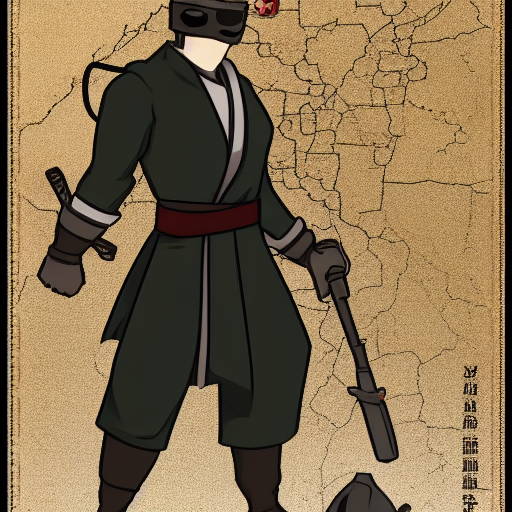
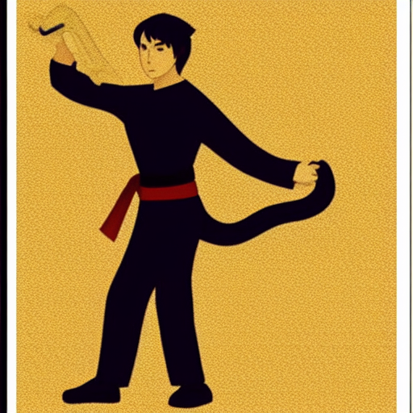
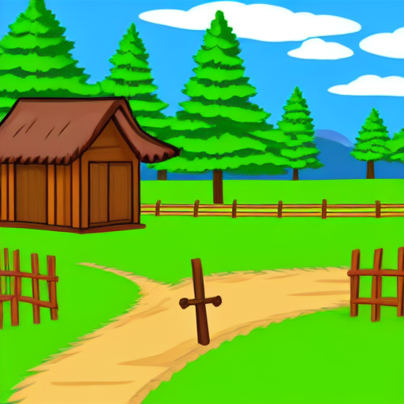

# 🌀 RogueEdu — MISSION G-1: Three Shinobi, One Shared Game

*(Workshop 1 · SG 13 · Genin Edition · VS Code Scroll · 30 minutes)*



**Name:** ______________________ **Squad:** ______ **My shinobi role:** ______________ **Machine:** ______

**Sensei-prepared before today (you can trust it):** every machine is signed in to GitHub,
your squad's team repository exists, Git identity is configured, and the baseline game
was verified by the sensei.

**The mission:** three shinobi. Two independent contributions. One playable game.
One shared history. The mission succeeds when **both improvements live in one game you
can play**, and you can **show the Git history that proves how they got there**.

---

**Village laws:**
1. **Predict before you run.** A wrong prediction is information, not failure.
2. **One change at a time.** Then run and observe.
3. After **90 seconds** stuck → raise your hand. That's the rule, not defeat.
4. **Write your evidence. Evidence is your rank.**
5. **"You decide. The engine acts."** — and a merge only *combines histories*.
   It never proves the game works. **You prove the game.**

**Shell Law — today's exception:** earlier scrolls spoke **Git Bash only**. This scroll
speaks **VS Code Source Control**, because that is what SG 13 teaches. Git Bash appears
only where you see the ⚖️ mark (the chakra check) and in the rescue guide. One
interface at a time — that is the law.

---

## 🥷 Your Squad — pick your shinobi (keyboard rotates at every phase line)

| Shinobi | Contribution | Works in |
| --- | --- | --- |
| **Loremaster** | The Elder's dialogue grows wiser | `rogue_edu/student_starter/classes.py` |
| **Arena-Master** | A second Slime guards the grove | `rogue_edu/student_starter/game_config.py` |
| **Scout** | Integrates both contributions, verifies the game | the `main` branch |

  

Each shinobi drives **their own machine** and their **own copy** (clone) of the squad
repository — three shinobi, three independent histories. Squad of four? Welcome the
**Co-Scout / Field Tester**: they pull the finished `main` independently and re-verify
everything in Phase 5.

**⚠️ Why separate files?** Two shinobi editing two *different* files cannot collide on
the same line — the usual source of merge fights. That makes a clean merge *likely*,
never *guaranteed* (a wandering hand can still edit off-territory). And remember Law 5:
even a clean merge proves nothing until the game runs.

**The map of one change** — every edit travels five stations. Say them aloud once:

> **Working folder** → *(stage)* → **Staged** → *(commit)* → **Local history** →
> *(push)* → **GitHub (remote)** → *(pull)* → **Teammate's machine**

Saving a file is **not** committing. Committing is **not** pushing. Pushing does
**not** update anyone's machine. Only a **pull** does.

---

## 🥷 PHASE 0 — Mission Briefing (1 min)

Assign roles, sit at your machines, open this scroll on the Navigator's screen.
Retrieve your squad's repository link from the **LMS (Google Classroom)** — your
sensei posted it there — and write it here: `________________________________`

---

## 🥷 PHASE 1 — Clone the Village Game (5 mins, all three machines)

**Steps (each shinobi, own machine):**
1. VS Code → **Welcome tab → "Clone Git Repository"** (or `Ctrl+Shift+P` →
   **Git: Clone**). Paste the squad URL, choose **Documents**, **Open** when asked.
2. ⚖️ Open a terminal in VS Code (`Ctrl+`\`), enter the game folder and run the
   chakra check (Git Bash):
   ```
   cd rogue_edu
   python check_my_class.py
   ```

**Expected result — the village is healthy:**
```
[PASS] Hero 'BraveKnight' inherits Hero -- the engine drives its turns from your keyboard.
[PASS] Villain 'Slime' inherits Villain and act() returned AttackAction(dx=1, dy=0).
[PASS] NPC 'Elder' inherits NPC and interact() returned a SpeakAction.

Summary: 3 passed, 0 warnings, 0 failures.
```

3. ⚖️ Still in Git Bash, read your machine's history line:
   ```
   git log --oneline -1
   ```

**✅ Evidence 1 of 3 — Git history.** All three machines write the **same short hash**:
`________`  (Three machines, one shared history. That is the point.)

**If it differs:** a machine cloned before the sensei's final prep → re-clone (rescue card #5).

---

## 🥷 PHASE 2 — Two Paths Diverge (6 mins — Loremaster & Arena-Master in parallel; Scout plans)

**Loremaster (own machine, own clone):**
1. Click the **branch name in the status bar** (bottom-left) → **Create new branch…**
   → type exactly: `feature/elder-lore` → Enter. *(You branched from `main`.)*
2. Open `rogue_edu/student_starter/classes.py`. Find the Elder's `interact` and make
   the quoted line read **exactly**:
   ```python
   def interact(self, view):
       return SpeakAction(
           "Two slimes now guard this grove, traveler. They strike only when close "
           "-- keep your back to a corner!"
       )
   ```
3. **Save.** **Predict:** when your words reach the merged game, bumping the Elder
   will show: ________________________________

**Arena-Master (own machine, own clone):**
1. Status bar → **Create new branch…** → exactly: `feature/second-slime`.
2. Open `rogue_edu/student_starter/game_config.py`. Directly **below** the existing
   `game.add_villain(Slime(x=7, y=7))` line, add:
   ```python
   game.add_villain(Slime(x=4, y=7))  # grove guard (Arena-Master)
   ```
3. **Save.** **Predict:** the grove guard will behave ______________ compared to the
   first slime. *(Think: did anyone change the Slime's `act`? Read your file.)*

**Scout (own machine, own clone — never edits a feature file):**
1. ⚖️ In Git Bash, watch the remote while your squad works: `git fetch origin`
   then `git branch -r`. Record the moment each branch appears:
   `feature/elder-lore` seen at ____:____ · `feature/second-slime` seen at ____:____
2. Write your integration plan: which branch merges first? What will a *clean merge*
   prove, and what will it **not** prove?
   ______________________________________________________________

**Look around the squad:** three machines, three `main` branches untouched, two new
branches growing in private. Nobody's game broke. **That is what branching is for.**

---

## 🥷 PHASE 3 — Ledger Your Work (5 mins — Loremaster & Arena-Master in parallel)

**Each developer, on their own machine and branch:**
1. Open the **Source Control panel** (`Ctrl+Shift+G`). Your file sits under
   **Changes** with an **M** badge. Predict first: has your edit entered history yet?
   ______ *(No. Saved ≠ committed.)*
2. Hover the file → click the **`+` (Stage)** icon. The file moves to **Staged**.
   *(Staging = putting the change in the envelope. Committing = sealing it.)*
3. Type a message that follows the formula, then click **Commit**:
   - Loremaster: `lore: Elder warns of the second slime and its strike range`
   - Arena-Master: `arena: second slime guards the grove`
4. Click **Publish Branch** (the cloud button). Your branch — which exists only on
   your machine until now — flies to GitHub. This is **push**.
5. **Say what just happened:** my commit lives in ______ history and ______ history.
   *(local + remote — two places, one commit.)*

**Scout:** keep your fetch watch running. By the end of this phase you should see
**both** `origin/feature/...` branches on the remote.

**✅ Evidence 1 of 3 — Git history (grows):** each developer records their commit's
short hash: Loremaster `________` · Arena-Master `________`

---

## 🥷 PHASE 4 — The Scout Integrates (6 mins — Scout drives, squad watches)

**Scout's law — say it aloud before touching anything: "I am on main."**
(Check the status bar. Merging onto the wrong branch is the classic Genin mistake —
rescue card #4 tells the story.)

1. Status bar → switch to **`main`** → Source Control **⋯ menu → Pull**.
   *(Fetch happened in Phase 2; Pull = fetch + integrate into your working folder.)*
2. `Ctrl+Shift+P` → **Git: Merge Branch…** → choose **`origin/feature/elder-lore`**.
   Repeat → **`origin/feature/second-slime`**.
   *(Don't see them? `Git: Fetch` first — rescue card #2.)*
3. Push the integrated `main`: Source Control panel → **Push**.
4. ⚖️ Verify the village (Git Bash):
   ```
   cd rogue_edu
   python check_my_class.py
   git log --oneline --graph -6
   ```

**Expected result:** `Summary: 3 passed, 0 warnings, 0 failures.` — and the top of
your graph shows a **merge commit with two parents** (two lines flowing in).

**✅ Evidence 2 of 3 — Integration.** Scout records:
- Merge output said "no conflicts": ______ (VS Code merged without asking you to fix anything)
- Merge commits visible in the graph: ______ (how many?)
- **The honest line, copied verbatim:** a clean merge proves ______, not ______.
  *(histories combined · a working game)*

**⚖️ Teacher's Tale (optional, ~2 min, projector):** last term a squad merged cleanly
and the chakra check said 3 PASS — and the game still crashed the moment a slime
walked farther than four tiles. One missing word: `WaitAction` was never *imported*.
Ask your sensei for the full story — or live it in the rescue guide's Tale.

---

## 🥷 PHASE 5 — The Village Reunites (4 mins — all three shinobi)



**Each developer (Loremaster, Arena-Master):**
1. Status bar → switch to **`main`** → **Pull**.
2. Your game just changed **because you pulled**. Nobody sent you files. History did.

**All three shinobi — verify the SAME combined game:**
1. ⚖️ Chakra check once more on `main`: expect `Summary: 3 passed, 0 warnings, 0 failures.`
2. Launch with the lab's **shared RogueEdu environment** — your sensei built it once
   on this computer, outside every clone:
   ```
   ~/rogue-edu-env/Scripts/python.exe app.py
   ```
   Then open **http://127.0.0.1:5000**. `ModuleNotFoundError: flask`? Rescue card #6.
3. **Observe and check your predictions:**
   - ______ slimes on the board *(look for two 🟢 — one at (7,7), one at (4,7))*
   - Bump the Elder 🧙: his line reads ________________________________
   - The grove guard behaves ______________ the first slime *(predicted in Phase 2 —
     it **chases exactly like the first**: nobody touched the Slime's `act`)*

**Squad of four — Co-Scout / Field Tester:** on the fourth machine, pull `main`
independently and re-verify all three evidence categories. Your squad's rank is
doubled-checked by a shinobi who never touched either branch.

**✅ Evidence 3 of 3 — Actual game verification.** Every shinobi records their own
observations above. **A merge combined the histories. The chakra check passed. Only
running the game proved the mission.**

---

## 🥷 PHASE 6 — Evidence Scroll & Exit (3 mins)

**Your three evidence categories — all three, or the mission is incomplete:**
| # | Category | Where it lives |
| --- | --- | --- |
| 1 | **Git history evidence** | commit hashes, branch names, merge commits in the graph |
| 2 | **Integration evidence** | clean merge output, two-parent merge commits on `main` |
| 3 | **Actual game verification** | chakra check + what you SAW: two slimes, the Elder's new words |

**Exit questions — answer in your scroll:**
1. The **M** badge appeared when you saved. What had changed on disk, and what had
   **not** changed in history? ______________________________________________
2. The instant after **Commit**, who could see your work? After **Push**?
   ______________________________________________
3. Your teammate pushed to `main`. When did YOUR game change?
   ______________________________________________
4. The merge said "no conflicts." Did that prove the game works? What proved it?
   ______________________________________________
5. **Fetch vs Pull:** what does `fetch` show you, and what does `pull` do on top of it?
   ______________________________________________

**Rank earned:** ________  **Sensei stamp:** ________
*Genin who complete all three evidence categories are mission-ready for SG 14's
group missions — where the squad meets a real merge conflict, on purpose.*

---

**Rescue guide & the full Teacher's Tale:** `mission_g1_teachers_tale_rescue.md`
**Sensei preparation:** `mission_g1_teacher_prep.md` · **Fallback missions:** `mission_g1_fallbacks_ab.md`
