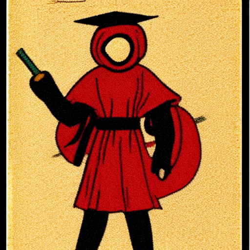
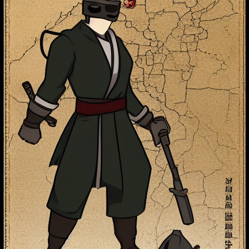
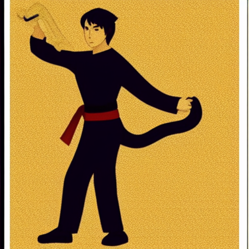

# 🌀 RogueEdu — MISSION G-2: Three Shinobi, One Trusted Change

*(Workshop · SG 14 · Genin Edition · VS Code + GitHub scroll · 20 minutes)*


**Name:** ______________________ **Squad:** ______ **My shinobi role:** ______________ **Machine:** ______

**Sensei-prepared before today (you can trust it):** squad repository live on GitHub · every
machine signed in · Git identity configured · the **GitHub Pull Requests and Issues
extension** installed · baseline game verified by the sensei.

**The mission:** a contribution is **not trusted because its author says it works.**
The squad **reviews, discusses, improves, integrates, and verifies** — and only then
does a change enter the village game.

> ## ⛩️ THE STAMP LAW
> **No merge without a review stamp.**
> 
> The stamp is a **squad law** — our discipline, our proof of care. GitHub *can* be set
> to enforce it, but on our private team repos it is **not enforced by the machine**.
> The shinobi enforce it, because a village that skips review ships broken games.

---

**Village laws (carried from G-1):**
1. **Predict before you run.** 2. **One change at a time.** 3. **90 seconds stuck →
raise your hand.** 4. **Write your evidence. Evidence is your rank.**
5. **"You decide. The engine acts."** — and a **Pull Request is a request, not a pull**:
it changes nothing until reviewed, merged, and pulled.

**New law for this mission:** a **PR proposes; a review judges; a merge publishes; a
pull delivers.** Four different acts — never collapse them into one.

**Shell Law:** VS Code first, exactly like G-1. Git Bash only at the ⚖️ marks.
Today one more door opens: the **GitHub web page** for pull requests. Same village,
different gate.

---

## 🥷 Roles today (they evolve — they do not disappear)

| Shinobi | Today's title | Duty |
| --- | --- | --- |
| **Loremaster** | **Change Author** | Makes the change, opens the PR, answers the review |
| **Arena-Master** | **Code Reviewer** | Reads the real diff, hunts for warnings, stamps or rejects |
| **Scout** | **Integration Steward** | Guards the Stamp Law, oversees the merge, verifies the game |

  

Role rotation happens in the ILA (*The Conflicting Scrolls*). Today's cycle is one
pass with everyone in seat — tomorrow's mission rotates the chairs.

**⏱ Timing:** 18 minutes of active steps + 2 for briefing, transitions, and
contingencies. The scroll shows every phase budget.

---

## 🥷 PHASE 0 — Briefing & the Stamp Law (2 min)

Roles seated. Read the Stamp Law aloud, in unison, **twice**.
The sensei shows the squad's GitHub repo on the projector — today the village hall is
open. What the mission is about: **trust is earned by evidence, not by confidence.**

**📋 THE DESIGN REQUIREMENT — the standard the review will enforce:**

> **Make the Slime moderately stronger while keeping it playable and within the
> engine's supported limits. Your implementation must pass the checks without
> warnings.**

Every judgment today measures against this sentence. "Moderately," "playable," and
"without warnings" are not feelings — each one is checkable: the ranges are known
(`hp` in [1, 200], `attack_power` in [0, 40]), the clamps speak loudly, and the chakra
check tells the truth about warnings.

---

## 🥷 PHASE 1 — The Author Forges a Change (4 min — Loremaster drives)

1. Status bar (bottom-left) → **Create new branch…** → exactly: `feature/slime-stats`
2. Open `rogue_edu/student_starter/classes.py`. Find the Slime's `__init__` and make
   the line read **exactly**:
   ```python
   super().__init__("Slime", x, y, hp=10, attack_power=99)  # make it truly dangerous
   ```
3. **Save.** ⚖️ Chakra check (Git Bash, from `rogue_edu/`):
   ```
   python check_my_class.py
   ```
   **Look closely.** The check says 3 passed — and something else. Copy the warning
   line, word for word: ________________________________________________
4. **Predict before the PR:** your scroll claims the slime becomes "truly dangerous."
   After this warning, what attack_power will the game actually use? ______
   Does this first attempt satisfy the Design Requirement? ______ *(The Reviewer will
   rule on exactly this question — with your warning as evidence.)*
5. Stage (`+`), commit: `stats: slime attack 99 -- truly dangerous`, **push** the branch.

**⚠️ Do NOT fix the warning yet.** The warning is not your problem anymore — it is the
**reviewer's evidence**. A real author ships the PR; the review decides.

---

## 🥷 PHASE 2 — The Author Proposes (3 min — Loremaster)

A **Pull Request proposes changes; it is not `git pull`** — it changes nothing by
itself. It is an **invitation to judge**.

1. In VS Code, after the push, use the **GitHub Pull Requests** panel: **Create Pull
   Request** → base: **main** ← compare: **feature/slime-stats**.
   *(Web fallback: github.com → your squad repo → "Compare & pull request" banner.)*
2. **Title** (formula): `stats: make the slime dangerous`
3. **Description — the author's claim, in two sentences:**
   > What it changes: ________________________________________________
   > Why the village wants it: ________________________________________
4. **Create** the PR. **Predict:** what has changed on GitHub? On your machine? On your
   teammates' machines? (Three different answers — say them aloud.)

---

## 🥷 PHASE 3 — The Reviewer Judges (5 min — Arena-Master drives)

**The Stamp Law begins here.** You do not read the description and believe it. You
inspect the **actual changes**.

1. Open the PR (GitHub Pull Requests panel → the PR → **Overview**, then **Files
   Changed**). Confirm the diff touches **one line of one file**. Anything more = the
   author wandered off-territory — say so.
2. ⚖️ Evidence run on **your own machine** (Git Bash):
   ```
   git fetch origin
   git checkout feature/slime-stats
   cd rogue_edu && python check_my_class.py
   ```
3. **The Reviewer's Rubric — check all five, in order:**
   - **Design requirement:** moderately stronger, playable, within limits, and
     **without warnings** — does the change satisfy the sentence from Phase 0? ______
   - **Valid ranges:** hp lives in [1, 200]; attack_power lives in **[0, 40]** — is the
     value inside? ______
   - **Warnings:** did the chakra check print a WARN? Quote it:
     ________________________________________________
   - **Game behavior:** will the board show the claimed behavior? (Evidence, not vibes.)
   - **Readable:** would the next shinobi understand this line? ______
4. **Verdict:** the warning says 99 was **clamped to 40** — the engine quietly refused
   the dangerous number, and the WARN told everyone. The claim is false.
   **The argument you will hear — and the answer:** *"But 40 is inside [0, 40]!"*
   In-range is **not** the requirement. Playable: a 40-damage bite downs the 25-hp
   starter hero in **one hit** — the game becomes unwinnable. **Legal ≠ appropriate.**
   The Design Requirement is the standard, not the clamps.
   In the PR: click the line, **leave a comment with the quoted WARN**, then
   **Finish review → Request changes**, summary: *"Engine clamps 99→40 (WARN). The
   mission 'truly dangerous' fails. Propose values inside [0, 40] — and honestly."*

**⚠️ Honest machinery note:** Request changes **asks** — under the Stamp Law the merge
button still works. **The squad enforces the stamp, not the machine.** Merging without
a stamp is not a hack; it is a *violation*.

---

## 🥷 PHASE 4 — The Author Answers (3 min — Loremaster)

Feedback is not an insult; it is free testing by a fresh pair of eyes.

1. On your branch, make the line read **exactly**:
   ```python
   super().__init__("Slime", x, y, hp=14, attack_power=6)  # tougher, but fair
   ```
   **Why exactly 6 and 14?** The Design Requirement, satisfied on purpose:
   attack 3 → **6** doubles the old bite — but a 25-hp hero still survives **five** of
   them; hp 10 → **14** lets the slime last **three** hero bites instead of two.
   Harder — and still winnable. Both values inside the ranges: **no clamps, no
   warnings.**
2. ⚖️ Chakra check: expect `Summary: 3 passed, 0 warnings, 0 failures.`
3. Stage, commit: `stats: attack 6, hp 14 -- tough but fair (review fix)`, **push to
   the same branch**. The PR **updates itself** — new commits appear for review. No new
   PR, no ceremony: the same scroll, a cleaner draft.

---

## 🥷 PHASE 5 — The Stamp (1 min — Arena-Master)

Re-open **Files Changed** — confirm only the intended line changed, values inside
[0, 40], chakra green. **Finish review → Approve**, summary: *"Values valid, warning
gone, mission honest. Stamped."* 🌀

---

## 🥷 PHASE 6 — Integration & Verification (2 min — Scout drives, all verify)

1. Scout merges the PR: **Merge pull request** → open the ▾ dropdown and choose
   **Create a merge commit** (never *Squash and merge* / *Rebase and merge* — the
   rollback lesson depends on merge commits) → confirm.
   *(Scout says the law aloud first: "Stamped?" — "Stamped.")*
2. **All three shinobi** switch to `main`, **pull** (`Sync`/SC panel → Pull).
3. ⚖️ Chakra check on main: expect `Summary: 3 passed, 0 warnings, 0 failures.`
4. Launch the game and **verify the claim — now an honest one:** the slime bites
   harder. Evidence: a bite costs ______ hp (was 3, now 6).

**The final distinction — write it in your scroll:** the first version was
**technically** *processed* by the engine but **wrong** (a lying claim + a silent
clamp). The approved version is technically correct **and** an appropriate gameplay
decision. Review checks both.

**✅ Evidence (all three, or the mission is incomplete):**
| # | Evidence | Who recorded |
| --- | --- | --- |
| 1 | **History evidence** — the PR number + both commit messages | Loremaster |
| 2 | **Review evidence** — the quoted WARN + the Request-changes comment + the stamp | Arena-Master |
| 3 | **Game verification** — green chakra on main + the 6-damage bite, observed | Scout |

**Rescue guide & drills:** `mission_g2_teachers_tale_rescue.md` ·
**ILA — The Conflicting Scrolls:** `mission_g2_ila_conflicting_scrolls.md` ·
**Sensei prep:** `mission_g2_teacher_prep.md`
